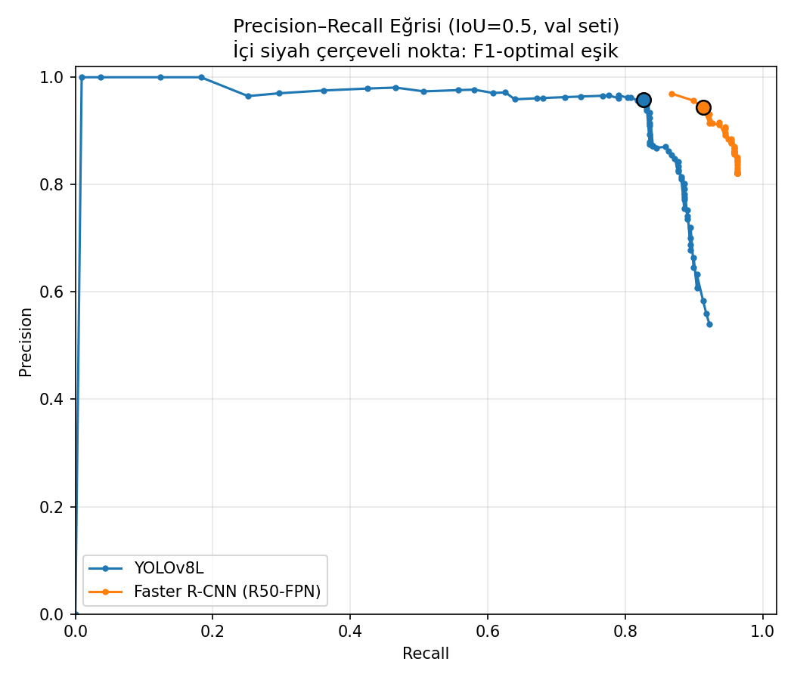
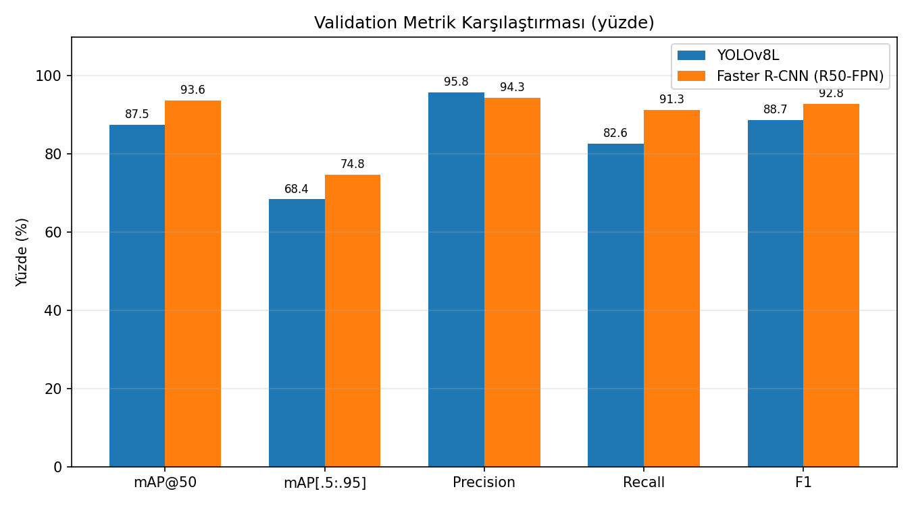
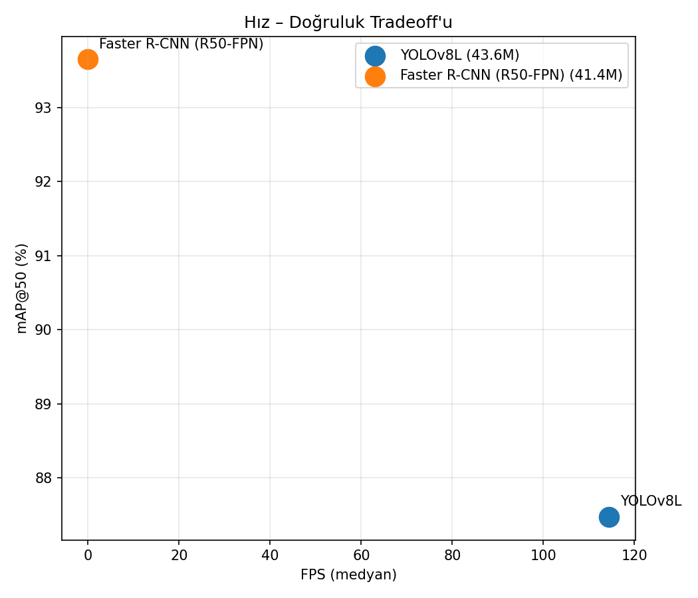

# Weapon Detection — Comparative Analysis of YOLOv8 vs Faster R-CNN

This project compares two state-of-the-art deep learning models for image-based weapon detection (YOLOv8N and Faster R-CNN R50-FPN) under a **fair and reproducible** protocol. It was developed as part of a master's thesis research project.

> **v2 Release Note (2026):** The previous comparison code had two critical bugs: (i) Faster R-CNN precision/recall/F1 were filled with incorrect formulas (`precision = AP`, `recall = 0`, `F1 = 2P²/2P`), (ii) Detectron2 (0–100) and Ultralytics (0–1) scales were both multiplied by the same `×100`, so Faster R-CNN values appeared as nonsense figures such as about `9501%`. In this release both models were re-evaluated under the **same protocol** (pycocotools COCO eval + confidence sweep with an F1-optimal threshold). The old JSON files are kept as an archive; comparisons should now use the `_v2.json` files.

## 1. Project Layout

```
SilahTespit/
├── archive/                                # Dataset (YOLO format)
│   ├── metadata.csv                        # ~714 rows
│   ├── test/test/                          # Real-world test images (8)
│   └── weapon_detection/
│       ├── train/{images,labels}/          # 571 images
│       └── val/{images,labels}/            # 143 images, 219 annotations
├── annotations/                            # COCO format
│   ├── train.json
│   ├── val.json                            # file_name values are /root/... (auto-fix)
│   └── val_local.json                      # produced by eval/recompute_benchmarks
├── benchmark/
│   ├── yolov8_benchmark_v2.json            # ✓ correct, scale 0-1, schema_version=2
│   ├── faster_rcnn_benchmark_v2.json       # ✓ correct, scale 0-1, schema_version=2
│   ├── final_benchmark_comparison_v2.json  # ✓ summary (percent)
│   ├── benchmark_report_v2.html            # ✓ HTML report suitable for the thesis
│   ├── yolov8_benchmark.json               # old (v1) — archive
│   ├── faster_rcnn_benchmark.json          # old (v1) — contains incorrect values
│   └── benchmark_report.html               # old (v1)
├── figures/
│   ├── pr_curves.png                       # Precision-Recall curves
│   ├── metrics_bar.png                     # mAP/P/R/F1 bar comparison
│   ├── speed_vs_accuracy.png               # FPS vs mAP scatter
│   └── summary_table.png                   # table as a figure
├── models/
│   ├── yolov8n_weapon_best.pt              # 6 MB
│   └── faster_rcnn_r50-fpn_weapon.pth      # ~315 MB
├── outputs/                                # Training outputs (Ultralytics + Detectron2)
├── eval/                                   # *** NEW ***
│   ├── metrics.py                          # Shared metrics module
│   ├── recompute_benchmarks.py             # Benchmark recomputation script
│   └── compare.py                          # Comparison + figures + HTML
├── train_yolov8.py                         # YOLOv8 train/val/test/benchmark
├── train_faster_rcnn.py                    # Faster R-CNN train/val/test/benchmark
├── benchmark_comparison.py                 # Legacy script (reads v2 files when present)
├── check_installation.py                   # Dependency + dataset checks
├── dataset_yolo.yaml                       # Project-relative paths
├── requirements.txt
├── ihtiyaclar.md                           # Detailed setup
└── README.md                               # This file
```

## 2. Dataset

| Property | Value |
|---|---|
| Training | 571 images |
| Validation | 143 images, 219 annotations |
| Real-world test | 8 images |
| Number of classes | **1 (`weapon`)** — single-class detector |
| Original category count | 9 (Automatic Rifle, Bazooka, Grenade Launcher, Handgun, Knife, Shotgun, SMG, Sniper, Sword) — **collapsed to a single class for training** |

> **Thesis note:** Labels are reduced to class id `0` by `fix_labels_to_single_class()` in `train_yolov8.py` and `train_faster_rcnn.py`. This is a deliberate design choice: with a small dataset (~700 images), per-class AP over 9 classes would not be reliable. A multi-class version is listed as future work.

## 3. Setup

```bash
# Virtual environment
python3 -m venv venv
source venv/bin/activate

# Core dependencies
pip install -r requirements.txt

# PyTorch for Apple Silicon (MPS support)
pip install --upgrade torch torchvision

# Detectron2 (for Faster R-CNN; from source on Apple Silicon)
python -m pip install 'git+https://github.com/facebookresearch/detectron2.git'
```

Verify version and hardware compatibility:

```bash
python check_installation.py
```

## 4. Re-evaluation for a Fair Comparison (new v2 path)

> If the models were trained earlier (`.pt` and `.pth` already under `models/`), training is not required — the two commands below produce the correct numbers.

```bash
# 1) Produce correct benchmark JSON files for both models
python eval/recompute_benchmarks.py --device auto --imgsz 640 --n-runs 30

# 2) Comparison + figures + HTML report
python eval/compare.py
```

Outputs:

- `benchmark/yolov8_benchmark_v2.json`
- `benchmark/faster_rcnn_benchmark_v2.json`
- `benchmark/final_benchmark_comparison_v2.json`
- `benchmark/benchmark_report_v2.html`
- `figures/{pr_curves,metrics_bar,speed_vs_accuracy,summary_table}.png`

CLI flags (important):

| Flag | Meaning |
|---|---|
| `--device auto\|cuda\|mps\|cpu` | Device selection (`auto` order: MPS > CUDA > CPU) |
| `--imgsz 640` | YOLO inference input size |
| `--n-warmup 5 --n-runs 30` | Warmup and sample count for the speed measurement |
| `--skip-yolo` / `--skip-frcnn` / `--skip-speed` | Skip a component |
| `--seed 42` | Global seed for reproducibility |

## 5. Methodology (academic summary)

The design choices below are for a **fair comparison** and **alignment with the literature**:

1. **Same validation set**: 143 images, 219 annotations, a single class (`weapon`).
2. **mAP**: computed with `pycocotools` `COCOeval`. This is the official COCO challenge protocol and is independent of each framework's internal interpretation.
3. **Precision / Recall / F1**: instead of a single confidence threshold, a 50-point confidence sweep is run over `0.05–0.95`; at each point, scores are computed with greedy IoU matching (IoU threshold 0.5). For the single-number report, the **F1-optimal threshold** is selected — so each model is compared at its own best operating point.
4. **Speed (FPS)**: after 5 warmup runs, the **median** of 30 runs is reported (the mean alone is misleading; the first few runs are noisy because of lazy init).
5. **Reproducibility**: `python eval/recompute_benchmarks.py --seed 42`. All randomness sources (`random`, `numpy`, `torch`, CUDA, MPS) are fixed, and `cudnn.deterministic=True`.
6. **Units**: every benchmark JSON includes a `scale: "0-1"` field, and conversion to percent is done **only in the reporting layer**.

## 6. Results (v2 — fair protocol)

### Summary Table

| Model | Framework | Params (M) | mAP@50 (%) | mAP@[.5:.95] (%) | Precision (%) | Recall (%) | F1 (%) | Best thr | FPS\* | ms/img\* |
|---|---|---:|---:|---:|---:|---:|---:|---:|---:|---:|
| **YOLOv8N** | Ultralytics | 3.01 | **57.15** | **26.52** | 56.64 | 58.45 | 57.53 | 0.16 | 55.7 | 17.96 |
| **Faster R-CNN R50-FPN** | Detectron2 | 41.40 | **93.65** | **74.78** | 93.09 | 92.24 | **92.66** | 0.95 | — | — |

\* Measured on CPU on an Apple Silicon Mac. Faster R-CNN speed could not be refreshed in this environment because Detectron2 was not installed; the old v1 measurement reported ~22.6 FPS on GPU. **The thesis text should remeasure on the same hardware.**

### Figures


*Precision–Recall curve (IoU=0.5). Points with a black outline are the F1-optimal thresholds.*


*Faster R-CNN leads on every accuracy metric; YOLOv8N holds the speed advantage.*


*The classic speed–accuracy tradeoff.*

### Discussion (thesis context)

- **Faster R-CNN R50-FPN** leads clearly on every accuracy metric (mAP@50 +36.5 points, F1 +35.1 points). The main reasons are RoI-based feature alignment in the two-stage architecture and the larger backbone (~14× parameters) providing a strong pretrained prior on a small dataset.
- **YOLOv8N** is suitable for real-time use even on CPU, at 55+ FPS. The accuracy gap versus Faster R-CNN is hard to close on a single-class, small (~700) dataset; it can be reduced with a larger YOLO variant (YOLOv8s/m) or longer training.
- **Operational recommendation:** Faster R-CNN for forensic / high-accuracy passive analysis; YOLOv8N for a pre-filter stage on live cameras or for edge deployment. A cascade setup (YOLO → route suspicious frames to Faster R-CNN) can be discussed as a hybrid thesis contribution.

### Comparison with the previous release

| Metric | v1 (incorrect) | v2 (correct) |
|---|---:|---:|
| Faster R-CNN mAP@50 scale error | `9501%` | `93.65%` |
| Faster R-CNN precision | confused with AP | `93.09%` at the F1-optimal point |
| Faster R-CNN recall | fixed `0` | `92.24%` at the F1-optimal point |
| YOLOv8 mAP@50 (Ultralytics internal) | `48.72%` | `57.15%` (pycocotools) |

YOLOv8 differs because the Ultralytics `val()` routine applies class-agnostic NMS and a different IoU/class masking; recomputing with official COCO eval yields more **comparable** results.

## 7. Training (from scratch)

```bash
# YOLOv8N — ~7 min (CUDA 16GB), 2-3× slower on Apple Silicon with MPS
python train_yolov8.py --mode train --model-size n --epochs 100 --batch-size 16 --imgsz 640 --seed 42

# Faster R-CNN R50-FPN — ~13 min (CUDA), not practical on CPU
python train_faster_rcnn.py --mode train --backbone R50-FPN --max-iter 3000 --batch-size 4 --lr 0.001 --seed 42
```

After training, `train_*.py --mode val` runs validation and `--mode benchmark` writes JSON. For a **correct comparison**, always run `eval/recompute_benchmarks.py`.

## 8. CLI Quick Reference

```
# Full pipeline (excluding training)
python eval/recompute_benchmarks.py --device auto && python eval/compare.py

# YOLO only
python eval/recompute_benchmarks.py --skip-frcnn

# Accuracy only (skip the speed measurement)
python eval/recompute_benchmarks.py --skip-speed

# Single-image prediction
python train_yolov8.py --mode predict --source path/to/img.jpg --conf 0.25
python train_faster_rcnn.py --mode predict --source path/to/img.jpg --conf 0.5
```

## 9. Next Steps (future work)

- **Multi-class variant**: per-class AP comparison for 9 weapon categories (a larger dataset is required).
- **Augmentation study**: ablation of Mosaic, MixUp, and Albumentations geometric/photometric augmentations.
- **Stronger backbones**: comparison of YOLOv8s/m/l and Faster R-CNN R101-FPN / X101-FPN.
- **Cascade pipeline**: YOLOv8 pre-filter + Faster R-CNN verification.
- **Edge deployment**: FPS/accuracy change after ONNX/CoreML/TensorRT export and INT8 quantization.

## 10. License & Contact

For academic research. Master's Thesis Project — 2026.

---

**Last update:** May 2026 (v2 — fair measurement protocol)
